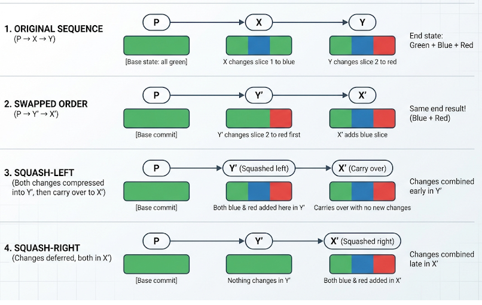

# git-rebubble
> Reorder (and squash) git commits sanely without changing the end result, or needing to blindly re-apply dropped changes, even reordering and squashing beyond merges or even before remerged branches!  
By Douglas Leonard, Copyright 2026

## License

This project is licensed under the following terms:  
MIT, attribution required  

## Overview
The simple version is just that.  Just try it and use it. The interface is similar to ```git rebase -i``` but it only supports pick (and a new fork to optionally reposition  forks in advanced use).  Rebase style reorders become much more clear and predictable and the end result never changes.  It fixes (from the author's perspective) [broken results you'd get from rebase -i](#when-rebase-is-broken-an-example), for some situations, and comes with several auto options for conflict resolution. 


### Brief explanation:  
It works with an automated series of "invariant swaps" that never change the resulting snapshot at the end of the two commits being "swapped." Of the two commits---in a snapshot (not patch) sense---we are always editing the history part, ie the first of the two, never the future/present, the latter of the two. This may sound contradictory to re-ordering commits, but it is not.  Re-ordering commits usually means reordering _changes_ to arrive at the same endpoint, and that still happens.   Two changes reversed should get to the same endpoint. If we edit the first snapshot, the invariant endpoint means the _changes_ for the second commit are fully determined.  The two patches have swapped, but the final snapshot (git tree) is unchanged. 

The full reorder is then just done by a series of swaps using bubble-sort.  On first glance it would seem that the number of replays is drastically larger than for rebase, and technically it is.  That could matter for performance, but auto merge still happens, and the total number of conflicted hunks for the user to handle is not generally more than necessary.  Every true conflict gets presented only once.

The full theory and its properties are detailed below.  
It works past merge commits and the tool implements side branch replay too so it works for reordering beyond re-merged forks too. 

<!-- START doctoc generated TOC please keep comment here to allow auto update -->

**Table of Contents**  *generated with [DocToc](https://github.com/ktechhub/doctoc)*

<!---toc start-->

  * [License](#license)
  * [Overview](#overview)
    * [Brief explanation:](#brief-explanation)
    * [When is it worse](#when-is-it-worse)
    * [General expectations/features:](#general-expectationsfeatures)
    * [Moving past merges](#moving-past-merges)
  * [Installation](#installation)
    * [Install uv if you don't have it](#install-uv-if-you-dont-have-it)
    * [Install and run the app/command:](#install-and-run-the-appcommand)
  * [Auto options](#auto-options)
    * [--auto-squash-left/right](#--auto-squash-leftright)
    * [--auto-squash-files](#--auto-squash-files)
    * [--force-left-files / --force-right-files](#--force-left-files---force-right-files)
  * [Understanding swaps, squashes, and moves](#understanding-swaps-squashes-and-moves)
    * [Symmetrizing the mental picture (a swap that isn't a swap)](#symmetrizing-the-mental-picture-a-swap-that-isnt-a-swap)
    * [squash-right (overwriting with P, not X)](#squash-right-overwriting-with-p-not-x)
    * [squash-left (overwriting with Y)](#squash-left-overwriting-with-y)
    * [Assemtry in squash language](#assemtry-in-squash-language)
  * [Theory: Preserved re-ordering problem (invariant reordering via invariant swaps)](#theory-preserved-re-ordering-problem-invariant-reordering-via-invariant-swaps)
    * [Turning it upside down](#turning-it-upside-down)
    * [Order (M*N) bubble sort, and why it's not bad.](#order-mn-bubble-sort-and-why-its-not-bad-)
  * [When rebase is broken: An example](#when-rebase-is-broken-an-example)
    * [.gitignore modification and other counter-examples (when the example above is wrong):](#-gitignore-modification-and-other-counter-examples-when-the-example-above-is-wrong)
    * [Flexibility with git-rebubble](#flexibility-with-git-rebubble)
  * [Forks and diamonds](#forks-and-diamonds)
  * [Addable features.](#addable-features-)
  * [Prior Work](#prior-work)
  * [Development](#development)
    * [Cloning](#cloning)
    * [Running your cloned app](#running-your-cloned-app)
    * [Adding dependencies](#adding-dependencies)
    * [Locking dependencies](#locking-dependencies)
  * [See Also](#see-also)

<!---toc end-->

<!-- END doctoc generated TOC please keep comment here to allow auto update -->
<!-- DON'T EDIT THIS SECTION, INSTEAD RE-RUN doctoc TO UPDATE -->

### When is it worse

Reordering 0123456789X to 06'7'8'9'X'1'2'3'4'5',  if every commit touched the same hunk, like something in uv.lock or some noisy .idea file, then `git rebubble` will see 5 commits cross 5 commits, creating 25 conflicts.  `git-rebase -i` will see possibly 10 conflicts unless you accept 6' and 1' versions, then only two.  The git-rebubble situation is not the same conflict 25 times.  It's 25 unique conflicts in the same place.   Git-rebubble has flexible options to help automate these situations, but you could do a `rebase -i -X ours` and edit the conflicting file on commit 1, forcing the change to replay through to the tip before rebubbling.  


### General expectations/features:
- The end result never changes.
- Unlike rebase, dropping a change in one commit where it should be dropped doesn't lose it from later commits where it shouldn't. (see point above)
- The same conflict will not generally show up twice or more times.
- Conflict resolution is more clear and well defined, both in principle, and hopefully in part by implementation.  Implementation may improve here too, to present reasonable merge views for things like add/modify  reorders (modify/delete cherry-picks).

### Moving past merges
The process allows to easily rearrange past merges, branch points, and even diamond graphs.  To move a commit past a merge, we don't need to replay the merge logic.  We just consider the merge as a change on our line that happened to have a second parent. This does not create evil merrges.  The conflict resolution model fits this well.  Ex: 

A->B->Y->X->F         A->B->X'->Y'->F'         
       /                   /
      Z                   Z

If the merge X, that brought in Z from a side branch moves back past feature Y on the main branch, you just edit X to no longer include Y and leave Z changes alone unless they conflict, in which case ask what they should look like without Y.  When you leave some Y-ish parts of Z out, they will just magically "re"-appear on Y downstream anyway, because as with all swaps, the Y' snapshot still is identical to the original X snapshot, including Y-ish parts of Z!  The merge with X' is still correct, and no remerge strategy is required.

See [Forks and Diamonds](#forks-and-diamonds) for how reordering based fork points works. It's a bit of a tack-on to the swap approach.

## Installation
### Install uv if you don't have it
```
curl -LsSf https://astral.sh/uv/install.sh | sh    # or with pip:  pip install pipx; pip install uv
```

### Install and run the app/command:
```bash
uv tool install "git+https://github.com/DSLeonard-coding/git-rebubble.git"
git-rebubble
```

To use ssh (if this is a private project) use:
```bash
uv tool install "git+ssh://git@github.com/DSLeonard-coding/git-rebubble.git"
```


## Auto options

### --auto-squash-left/right
These options do not squash entire commits.  You can use the squash todo verb in the editor for that. These options only squash conflicting non-swappable changes into one combined change with the final result, on all files or only on selected files. Squashing conflicted content just silences intermediary conflicting changes across a range.  The combined change can either be applied early (squash-left) or late (squash-right) within the pair of commits.    For "modify/delete" conflicts (P deletes relative to X, ie X adds the file, then Y modifies), this tends to bring context with the changes.  Continuing leftward swaps brings the combined modified commit back in time before its original creation. IE it brings back the first version of that file with its own changes to it.  Other changes to file that didn't conflict remain farther in the future.  The [--force-left option](#--force-left-files----force-right-files) can alter this choice.
New options are planned to allow only bringing the Y lines, which could be useful for things like .gitignore files.

### --auto-squash-files 
If a list of files is provided, this restricts auto-squash to those files.

### --force-left-files / --force-right-files
This is like auto-squash, except it forces overwriting all content of the specified files toward the left(or right), squashing all changes into the first overwrite (or after the last), for the specified files.  Useful for wiping out intermediate changes to certain files, especially noisy files. 

This is what forced squashes look like:



## Understanding swaps, squashes, and moves
In P->X->Y goes to P->Y'->X'  we are often thinking about moving X right several commits or moving Y right, but the situation appears a little assymetric, especially since we are saying the end point should never change.  Actually, the operation is symmetric.  Its our perspective that is asymmetric.  

### Symmetrizing the mental picture (a swap that isn't a swap) 
Thinking about the swap as X and Y creates an imbalance in the P->X->Y picture that doesn't actually exist.  We're swapping the two arrows, the differences, which are symmetrically placed, and the content overwrites involves content from either P or Y overwriting X, which is also symmetric (in principle you could make other arbitrary changes to X, but that's _mostly_ silly).  There's not even a left to right asymmetry here except that we usually think of the patches as right minus left, but cherry-pick actually sees them as P-X (P minus X)  and Y-X.  If we thought of the differences in reverse as patch P is P-X and patch X is X-Y, we'd actually say we're swapping the reverse patches P and X, not forward patches X and Y.  The difference is just an artifact of which side we label the patch by, and by how we _sometimes_ think about, and usually label, history! In particular, we use commit message titles describing Y-X changes, and we reorder by those titles in the pick editor.  

So the right way to see this is we are rewriting the content of X, making it either more Y like or more P like, while not changing either P or Y.  And in the commutative "swap" case we are doing both.  We are making all the X-related parts of X (in fact all the non-Y related parts) become P-like (so those _changes_ happen later) and all the Y related parts of X become Y-like (so those _changes_ happen in the P to X diff.)  If we continue these operations moving one way or the other we drag Y content left or P content right.  For example if the next move swaps from P Y' X'  To Y\'\' P' X',    the invariant says P' has the same contents as Y' had. The P label just moves to the middle, which now contains all the non-Y related parts of the original P, and P's non-Y related parent content gets drug behind it, just as P's was drug foward earlier, making the P patch label correct again, while Y content continues leftward.. 

A couple of these points are  shown below.  Notice in the second row that as X' moves right, the last content doesn't actaully become more X-like.  But the 3rd box becomes more Y-like _and_ more P-like!  Also notice in the last step the _content_ of the 3rd commit does not change.  Its name changes, but also its patch changes.  While it's the same content, in the second row it was called Y' because it added Y-ness (red), but in the 3rd row the exact same content is  called P' because it adds... green-ness!  The same idea is true for the last commit in the first two rows.


We still add P and Y back to Y' but here Y' partially wins because X is the base and changes beat no changes. This does something reasonable, because Y'' ends up in P's past, so we expect red in P, probably. 


### squash-right (overwriting with P, not X)
We can make Y' (the new middle) identical to P.  This "squashes" all the changes "to the right" into the X'-Y' patch.   But notice it moves P content toward the right.   In general, without a forced squash conflict resolution, X-like changes to P are absent from Y', so in an X-sense, Y' has become more P-like.  So P-content pushes to the right, and in the sort, we tend to overwrite content _behind_ commits moving to the right.  In the content sense it is P, not X that is overwriting to the right, and this can be important for understanding chained reorder operations.  

### squash-left (overwriting with Y)
We can instead make Y' content identical to the original Y , which is now also the final X'.  This moves all the changes into the Y'-P patch, and creates a null patch to X'.  In the sort, this operation tends to overwrite content _with_ commits moving to the left.  

### Assemtry in squash language
Notice the difference in the _behind_ and _with_ wording that comes from the asymmetric view of moving X.  X drags content in its wake on squash-right.  Y drags its own content on squash-left.


## Theory: Preserved re-ordering problem (invariant reordering via invariant swaps)

In this text commit letters like commit A represent the contents of the repo at that commit, ie the tree, not the patch that created A.  Likewise dA is a change, a patch that creates A, and dA_B  is a patch that creates the part of A that is applicable to B. It is part of the full dA.

It can be super difficult to  move a commit E from ABCDEF to AE'B'C'D'F';,  where you intend the final result to be unchanged, ie that D'=E and F'=F, again, in the snapshot sense.   rerere is not what solves this either. In fact for many situations `rebase -i` essentially just cannot do this reasonably. See [the rebase example](#when-rebase-is-broken-an-example) below.     The main point is that data is lost, and you don't get back to F, except in cases (see the link) where you wanted  all the commits from E through D to contain files introduced in now-future commits.   What you definitely could do to improve this is arrange to guarantee that C'=D, or alternatively D''=D in AD'B'C'D''E, where D'' is the "reconciliation" commit, and you can provide workflow to help minimize the loss and reconciliation, specifically by helping to shelve discarded changes in E' and re-attempt/re-offer them later.


This is ok, and the great thing is any rebase that preserves E and F can be just re-attempted until you are happy, but we get a simpler and sometimes more sensible solution  by reversing the flow.  Instead of moving a commit back and replaying every commit onto it, trying to remember how to do that, we  push the commit back one commit at a time, while always keeping the end point fixed, and just dropping bits that don't yet fit in the past we moved into.    


The process is easier.  The explanation is not because there is presently no familiar tooling to explain it from.

We can look at the original as: 
```code
A,  
B,  
C,  
D,  
D+dE,  
F   
```

And our goal is this series of commits, one commit per line:

```
A ) A  
E') A+dE_A  
B') (A+dE_A)+(dB+dE_B)  
C') (A+dE_A)+(dB+dE_B)+(dC+dE_C)    
D') (A+dE_A)+(dB+dE_B)+(dC+dE_C)+(dD+dE_D)      (ie E)  
F ) (A+dE_A)+(dB+dE_B)+(dC+dE_C)+(dD+dE_D)+dF    
```

And the total dE we started with is  dE_A+ dE_B+ dE_C+ dE_D.     
What rebase does is try to apply dE_A + dE_B + dE_C + dE_D  onto A to create A + dE_A, the second commit.  

But then you should discard (dB + dE_B)+(dC + dE_C)+(dD + dE_D) because they cannot apply to A.  If they could apply cleanly, they'd be part of dE_A by definition.  But anything we drop, is gone from the rest of the rebase process, and we are stuck trying to rewrite it, without a diff to pull it from, as we replay B through D onto E'.  This is terrible and bound to fail to reproduce F.  The natural tendency is to try to avoid losing work, so instead you try to include some broken version of (dB+dE_B)+(dC+dE_C)+(dD+dE_D) in E' just so you can fix it in later commits (often repeatedly) but not lose it.  This likely defeated the whole point of moving E back, IE to have a clean feature E commit not related to your other experimental B,C,D features.   


So again one solution is just to shelve the stuff that gets dropped, continue to re-offer it back along the way and in the end, force commit D' to be equal to E, ie force the end state to be the same, which is the same as saying to guarantee everything lost gets re-applied.  But we can do better than this and make it easier for the for user to get better commits along the way.   

### Turning it upside down 


Reversed rebase...
Just turn it upside now... push E back incrementally instead of stacking everything else on it incrementally.
we start here:
I
```code
A) A
B) B
C) C
D) D  
E) D +dE  = D + dE_A+ dE_B+ dE_C+ dE_D 
```
and then do this
II
```code 
A ) A
B ) B
C ) C
E') C + dE_A + dE_B + dE_C  
D') D + dE_A+ dE_B + dE_C+ dE_D  = E
```

and because D'=E we can always rebase F, G, etc onto it with no problem.  

In a rebase this looks a lot like swapping D and E, and that's the patch perspective.
The last two patches are +dE_A+dE_B+dE_C,  +dD+dE_D   so an E-like patch and E-modified D-like patch.  

Simply put, D, E  became E', D', a swap.  

But from a snapshot perspective,  D'=E.  The endpoint was invariant, didn't change, as required, which isn't a swap at all. All we did was apply dE onto C without the part that isn't needed yet for D.  

In practice, you just apply the full dE onto C with auto merge.  The dE_D part fails to merge.  If there are conflicts, the user only has one concern, figuring out what a C commit should look like if it had E applied.  And this is the REAL programming question.  It's not convoluted by implementation details or worrying about "what if I drop stuff and I don't get it back" or "what is the merge base here." You can safely just omit any parts of E that don't seem to fit in the present commit, and or modify anything you want as needed for the purpose of fitting onto a D-less C.  You don't even really need to know where you are or where you are going.  All you need to do is focus on making the current commit self consistent and include as much of E as reasonable, and deal with any issues that not having D cause.  You just have to keep in mind that we are not altering the tip, the present, so the goal is just to fix up the old commit, not add features.   

After you do this, it just repeats, so we go to the next "swap" and we try to apply E'-C to B, and should drop dE_C there and continue.  

But if at D' you fail to apply dE_B and dE_C and then, continue on you get this:  

Scenario X
```code
A       ) A
B'      ) A + dE_A
C'_wrong) B + dE_A
D'_wrong) C + dE_A   
E       ) D + dE_A+ dE_B + dE_C+ dE_D
```

In the end we still got feature E completed and caught up and fully applied to D.  And even commit B is fine.  The worst outcome here we have a couple of commits that were a work in progress and cleaned up later. We may alternatively accidentally apply dE_D too early.  But we don't need to diff the final result against the original, because the result is guaranteed. 
 
But the correct progression is:

I start point
```code
A) A
B) B
C) C
D) D  
E) D +dF  = D + dE_A+ dE_B+ dE_C+ dE_D = E
```

II
```code 
A ) A -------> unchanged snapshot
B ) B -------> unchanged snapshot
C ) C -------> unchanged snapshot                         
E') C + dE_A + dE_B + dE_C        ------->   merge E onto C, auto-merges except for removal of dE_D
D') D + dE_A + dE_B + dE_C + dE_D -------> unchanged snapshot  (D' = E)
```

III
```code 
A ) A                             -------> unchanged snapshot
B ) B                             -------> unchanged snapshot
C') B + dE_A + dE_B               ------->   merge E onto B, auto-merges except for removal of dE_C
D') C + dE_A + dE_B + dE_C        -------> unchanged snapshot
E ) D + dE_A + dE_B + dE_C + dE_D -------> unchanged snapshot
```

IV
```code 
A ) A                             -------> unchanged snapshot
B') A + dE_A                      ------->   merge E onto B, auto-merges except for removal of dE_B
C') B + dE_A + dE_B               -------> unchanged snapshot 
D') C + dE_A + dE_B + dE_C        -------> unchanged snapshot
E ) D + dE_A + dE_B + dE_C + dE_D -------> unchanged snapshot
```

At each step it is impossible to break the end result.   
At each step it is an automerge unless dE interacted with the specific commit we are swapping/re-constructing.  Most conflicts will only occur once.   
**At each step the user only has to figure out what THIS commit should look like, using information they should still have in their diffs!**  

And best of all, at the end, if you aren't happy, you still have a lot of options to try again.  The end result won't be harmed.  In scenario X you can either ignore it and go on, or reset --soft, unstage dE_B + dE_C, split the commits, and do another rebase to move them back after B' But you aren't forced to start over entirely.  

The biggest problem is there is no automated tooling for this flow.  


### Order (M*N) bubble sort, and why it's not bad.
The above example is great for moving one commit back but if you move, using numbers now, 01234567 to 05671234, you have to move 3 commits by 4 spaces ie you have order M*N potential commit merges. A traditional rebase has only M+N merges (12 vs 7 here).  BUT many of these will be small and or auto-merges. I can't say it will always work better.  The shelve and re-offer solution may be superior in some very complex re-orders, but generally the process here is much more clear.  At every step you are trying to make the commit make sense.  Instead of being afraid of dropping things, you actually want to drop changes that don't make sense, and let them get picked up in the future we came from where they do.  Twelve simple logical merges is much easier than 3 failed attempts at 4 impossible merges.  Furthermore, every conflicting hunk is still only offered once.  Although it's possible the hunk you're moving back conflicted with 5 intermediate changes of the same source. Then you will have to confront it 5 times, where other methods may not.

If we accept this, the general solution here is to think of every step above as an invariant "swap."  Then for a general reorder we can solve it by doing a bubble sort and applying these invariant swaps.  So all we need is code for the swap and for bubble sort.  The process works best with the bubble sort applied with tip to tail sweep order.   

It might be wise to break down complex reorders into separate block moves just to keep track of what's going on, but with a bubble tool you can still do that.  What makes even complex bubble sorts potentially ok is, again, the end result is always fine, and at every step the goal is just to drop stuff that doesn't belong (although that's not always quite obvious).  
  
And finally, the proposal from the first paragraph still has value.  Impose the endpoint with a readtree style commit, and provide tools to help get back there cleanly by stashing dropped changes. Everything is doable by hand but automation could help.  Anyway, that is not implemented in this repo.  


## When rebase is broken: An example
```
#!/bin/sh
rm -rf .git  rm *
git init

# create file A in commit A, B in commit B, etc

git commit -a -m "0" --allow-empty; 
for X in A B C D; do
echo $X >> $X; git add . ; git commit -m "$X"; git tag $X
done

#Add the letter E to files B through D and commit it all as E:

for X in B C D; do
echo E>> $X;
done
git commit -a -m "E"
git tag E 
```
run it, then...
```
(base) osboxes@osboxes:~/gittest$ grep . [A-Z]
A:A
B:B
B:E
C:C
C:E
D:D
D:E
```

now
```
git rebase i A
```
and do
```
pick 82e9047 B
pick d27fd77 E   # moved E here
pick 7a41074 C
pick 10c989e D
```
then we get conflicts and merge them...
```
(base) osboxes@osboxes:~/gittest$ git mergetool
Merging:
C
D

Deleted merge conflict for 'C':
  {local}: deleted
  {remote}: modified file
Use (m)odified or (d)eleted file, or (a)bort? d

Deleted merge conflict for 'D':
  {local}: deleted
  {remote}: modified file
Use (m)odified or (d)eleted file, or (a)bort? d
(base) osboxes@osboxes:~/gittest$ git rebase --continue
[detached HEAD 6454c0b] E
 1 file changed, 1 insertion(+)
Successfully rebased and updated refs/heads/master.
(base) osboxes@osboxes:~/gittest$ ls
A  B  C  D
(base) osboxes@osboxes:~/gittest$ grep . [A-Z]
A:A
B:B
B:E
C:C
D:D
```
If we assume here that the C file is only needed for the C feature and that the E in it is just to help C be compatible with E, then the only correct choice to make E' correct was to delete all the files except A.  And after doing so, the E contributions to them never came back. We lost the E part of C and D.  We weren't even given the CHANCE to bring them back!!!  rebase -i simply doesn't work for this use case, unless you have a mergetool that somehow stashes the lost bits. 

### .gitignore modification and other counter-examples (when the example above is wrong):
Alternatively we could have kept everything, but then our E commit, after B would already contain, in this example, C and D files that don't belong there, and C would also contain D.  This is what rebase can do well too, and is actually correct in other contexts. Imagine D introduced a lot of new stuff, but it included one utility file that E also happened to need, but with some upgrades of its own. Then it makes sense to bring the whole file with E. In still other cases the conflicting file might be a .gitignore file that D added, and that E needed one line in.  Then it would make sense to bring the file back with only that one "E-like" line (I can find no simple diff tools or merge strategies that are useful in this case). Maybe rebase and rebubble both can handle that (with the manual edit).  Sometimes even non-conflict files should be brought back, which no auto-merge tool will do of course. For these last two cases git rebubble followed by rebase -i with edit and -X ours is actually probably the easiest tool.  

### Flexibility with git-rebubble
There is no one automatic policy that makes sense in every situation. But in our case the correct choice required dropping changes that rebase will never offer back.  With rebase you cannot have a clean C/D-free E commit here AND keep your final state. 
  The problem with rebase reorders is that it only provides one solution, well, only one that doesn't lose changes from the end result.   With git-rebubble you can choose how to build Y', and X' absorbs whatever is left over. 

There are at least seven different categories of swap conflicts, and the other six are often well served by a `-X theirs` cherry-pick strategy.  This is the famous "modify/delete" case, seen as "Deleted by us" by `git status`, but us is P of  P->X->Y, so this really means added by X, and the conflict implies modified by Y.   So in P->Y'->X'  you can keep only Y parts,  keep the whole thing, or drop all of it.   In git-rebubble, everything ends up in X' regardless which one you choose. 

##  Forks and diamonds

The implementation also allows to push features back before forks or diamonds, or to push a feature that was before a fork, after it on the main line.   That's a little outside of the "theory" but not unrelated. While re-ordering the main line, you lock the merge commit result.  The basic principle is that the results of a merge should only depend on what features came before (vs after) it. When the merge is done, all those features should be included and reconciled, so when resolving the main line you add and remove features from the merge commit as they move before or after the merge.  Then when replaying a side branch, that branch may have changed, but the principle holds, that the result of the merge does not depend on where the fork occurred, or which sides were or weren't built with that feature, only on what commits came before the merge.   This might shift the  perspective on how  content arrived in the merge, from one branch, from both, or as a reconciliation required only when they came together, but it doesn't change the result, and it does not create evil merges.  The reconciliation remains motivated by the commits before it.

But side branches do need to be replayed on to their new parents, and this happens in a second stage.  Once they build up to the merge, the merge commit is simply reparented. 

To reduce work and blast radius, by default git-rebubble  only replays branches that are ancestors of the tip.  Replaying  non-merged branches could be made optional.  Presently those branches are not lost.  They aren't touched. They just reference the old history, that branches from yours at the first unchanged commit, and probably has "duplicate" commits.   These can be rebased manually still if desired. 


## Addable features.

The new strategy lends itself to a lot of new options to help with difficult cases. Some auto options like --auto-squash-left and --auto-squash-right already give flexible automation choices.  We can add "bulldoze-left-files=" for files that should just replace content as they swap left(right), "bulldoze" right is also possible but would pull from the P to X position.  We can never change the last commit contents on the right.  These are basically the same as the squash options, but for the whole file, for all commits, not just conflicts.  We could make (more) helpers to automatically or manually resolve the modify/delete conflicts in ways like the .gitignore case above.  When X adds and Y modifies we can have a custom patch that collects just the modifidied lines without the rest of the added file. 

## Prior Work

I stumbled into this idea entirely on my own, but of course that doesn't mean nobody else ever thought of anything similar.  I could not find anything similar within pure git.  Darcs' patch theory discusses commutative swaps in a way that relates.  Jujitsu ('jj') and its change-editing model achieve related goals through a completely different and more abstract tooling architecture, but I have not familiarized myself strongly.  The theory may strongly overlap but as far as I know, jj represents a complete abstraction around editing local git history.  The git-rebubble workflow is intended to work directly within the git mental model with no abstraction.


## Development

### Cloning 
If you want to develop the project locally, if you don't already have a clone make one:
```bash
git clone https://github.com/DSLeonard-coding/git-rebubble.git
cd git-rebubble
```

###  Running your cloned app
You can run your project from the cloned directory with:  
```
uv run git-rebubble
```
This will run ```uv sync``` and will run `git-rebubble` in the virtual environment.


### Adding dependencies
you can add new dependencies with
```
uv add some_dep
```
which will add some_dep to the pyproject.toml and will run a uv sync which will install it to your virtual environment in .venv/ , and finally will add it to your uv.lock file.  As shown above, some_dep can be a git repo.  

The some_dep specifier for git repos can optionally end in @ref where ref is a branch or tag. Do not be tempted to select a tag, or even version-limited branch, in the add command.  This will strongly restrict/break dependency resolution in even moderately bigger projects.  Source distribution is different from binary registry distribution. Version constraints essentially do not work for source-distributed dependencies.  This is what uv.lock is for. You should generally target the default branch or master/main/trunk. 


### Locking dependencies

Resolving dependency problems with source builds has become almost impossible with pip and was never great.  The lock file and various overrides make
uv a clear winner for source-based (non-pypi) GitHub sharing.

After some development you can update any added dependencies to the virtual environment with:
```bash
uv sync --refresh
```

This will add or remove dependencies in the virtual environment and in the ```uv.lock``` file but will not unpin previously locked versions unless needed to satisfy new constraints.  The `--refresh` option is not mentioned often but is important for source-distribution dependencies, because for reasons that are complicated, specifying version constraints on source dependencies is presently a disaster, so we instead should only specify the default branch or master/main/trunk.  Without ```--refresh``` uv sync will look for solutions in the local cache first, and it will not find the latest version from the repo.  If you are re-locking, this not usually what you want.

If you want to completely update version dependencies to the latest that match, you can run
```bash
uv lock --upgrade --refresh
```
or remove the `uv.lock` file and run `uv sync --refresh`

In the toughest cases you can even edit the uv.lock by hand to specify exact commit shas for your source dependencies, or use the included `overrides.txt` tools and then lock in.

You should always get your locks settled the way you want before committing to main branches.  In particular, you should usually remove any local source overrides and ```uv sync --refresh``` before committing.  Whatever version you have pinned in an app commit are the versions anyone who checks out that commit will get by default. 

The virtual environment is stored in .venv, and if in doubt, you can safely remove the whole directory and resync it.


---
## See Also

- Non-duplicating subtree/root-tree history:  
[git-alltrees](https://gitlab.com/douglas.s.leonard/alltrees/-/wikis/home)

This project was made and launched using the [dsleonard-pylaunch](https://github.com/DSLeonard-coding/dsleonard-pylaunch.git) cookie cutter.  To launch your own just do:
```bash
uvx cookiecutter https://github.com/DSLeonard-coding/dsleonard-pylaunch.git
```


